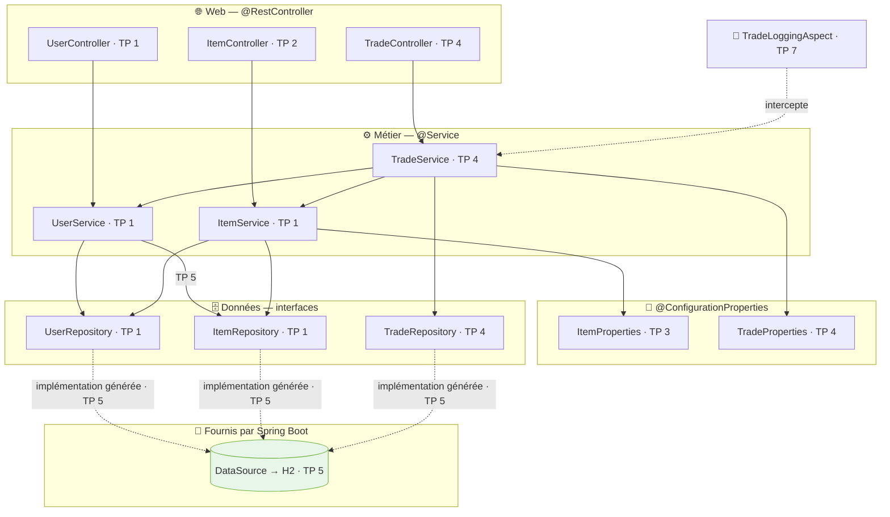
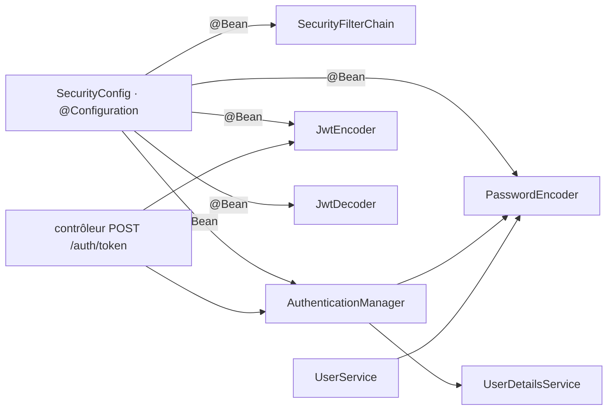
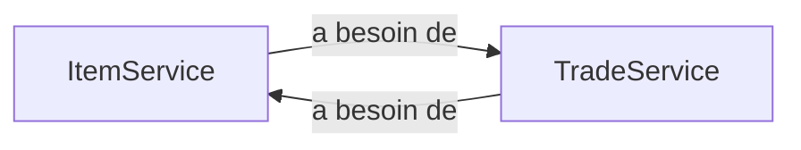

# Fiche 1 — Beans et injection

> `TP N` = notion vue à partir du TP N · ✅ à faire · ❌ à éviter · ⚠️ piège · 💡 astuce

## Déclarer un bean · `TP 1`

| Annotation | Couche | troc-api |
|---|---|---|
| 🌐 `@RestController` | web (JSON) | `UserController`, `ItemController`, `TradeController` |
| ⚙️ `@Service` | métier | `UserService`, `ItemService`, `TradeService` |
| 🗄️ `@Repository` | données | `InMemoryUserRepository` (TP 1 → 4) |
| 🧩 `@Component` | autre | `TradeLoggingAspect` (TP 7) |

- ✅ annoter la **classe**, ❌ jamais l'interface
- ⚠️ classe dans le package de `TrocApplication` (`fr.cours.troc`) ou un sous-package : `@SpringBootApplication` ne scanne que là

## Injection par constructeur · `TP 1`

```java
@Service
public class ItemService {
    private final ItemRepository items;            // ✅ final
    public ItemService(ItemRepository items) {     // ✅ 1 constructeur → pas de @Autowired
        this.items = items;
    }
}
```

- ✅ typer par l'**interface** · ❌ aucun `new` de service ou de repository
- 💡 1 bean = 1 seul exemplaire, partagé par tous

## Au démarrage · `TP 1`

🔍 **scan** `fr.cours.troc` → 🏗️ **création** des beans → 💉 **injection** dans les constructeurs

## Graphe des beans de troc-api

`A --> B` : A reçoit B dans son constructeur.



| Repositories | Implémentation |
|---|---|
| TP 1 → 4 | `InMemory…Repository` + `@Repository`, stockage dans une `Map` |
| TP 5 → | 🍃 **générée** par Spring Data JDBC (`extends ListCrudRepository<…>`) |

🍃 **Beans fournis par Spring :** `ObjectMapper` (JSON, TP 1) · `DataSource` (TP 5) · gestionnaire de transactions (TP 6)

### 🔒 Ajouts sécurité · `TP 9`

⚠️ noms tirés du TP 9, *à vérifier* dans votre projet.



💡 `@Bean` sur une méthode de `@Configuration` = bean d'une classe qu'on ne peut pas annoter (bibliothèque).

## Cycles · `TP 4`

**Le problème :** pour créer un bean, Spring doit d'abord créer tout ce que son constructeur demande.



🥚🐔 Créer `ItemService` exige `TradeService`, qui exige `ItemService`… Aucun des deux ne peut être créé en premier : ❌ l'application ne démarre pas (`… form a cycle`).

**Pourquoi les repositories ne posent pas ce problème :** un repository ne dépend d'aucun service. C'est une **feuille** du graphe : Spring le crée en premier, puis le donne à qui le demande.

| Situation | Résultat |
|---|:-:|
| `TradeService → ItemService`, `TradeService → UserService` | ✅ dépendances dans un seul sens |
| `UserService → ItemRepository` (supprimer un utilisateur et ses objets · `TP 5`) | ✅ un repository est une feuille |
| `ItemService → TradeService` **et** `TradeService → ItemService` | ❌ cycle |

**🛠️ Sortir d'un cycle :**
1. ✅ recevoir le **repository** de l'autre domaine plutôt que son service ;
2. ✅ garder un seul sens : dans troc-api, seul `TradeService` reçoit les autres services ;
3. 💡 si deux services ont vraiment besoin l'un de l'autre, déplacer le code commun dans un troisième service.

## ⌨️ IntelliJ · `TP 1`

⭐ = aide Spring, IntelliJ **Ultimate** (licence étudiante gratuite) · raccourcis Windows / Linux ; macOS et liste générale : [fiche 10](10-raccourcis-intellij.md)

| Raccourci | Effet |
|---|---|
| `Alt+Inser` > **Constructor** | génère le constructeur des champs `final` (tout cocher) |
| `Alt+Entrée` sur un champ `final` souligné | **Add constructor parameter** : le champ rejoint le constructeur |
| `Ctrl+Alt+B` sur `ItemRepository` | aller à l'implémentation (`InMemoryItemRepository`, `TP 1 → 4`) |
| `Ctrl+Alt+H` sur une méthode | qui l'appelle, et qui appelle l'appelant (hiérarchie d'appels) |
| ⭐ icône 🍃 dans la marge | aller au bean injecté · voir qui injecte ce bean |
| ⭐ `Could not autowire. No beans of '…' type found` | la même erreur qu'au démarrage, vue **avant** de lancer |

## 🚨 Erreurs au démarrage

| Message | 🔎 Cause | TP |
|---|---|---|
| `bean of type '…' that could not be found` | annotation oubliée / classe hors de `fr.cours.troc` | 1 |
| `required a single bean, but 2 were found` | 2 classes annotées pour la même interface | 1 |
| `… form a cycle` | 2 services se reçoivent mutuellement (voir 🔁 Cycles) | 4 |
| `Parameter 1 of constructor in …` | le **2ᵉ** paramètre (compté depuis 0) n'a pas de bean | 1 |

## 🔗 Pour aller plus loin

[Spring — IoC container](https://docs.spring.io/spring-framework/reference/core/beans.html) · [Spring Boot — Beans et injection](https://docs.spring.io/spring-boot/reference/using/spring-beans-and-dependency-injection.html)
