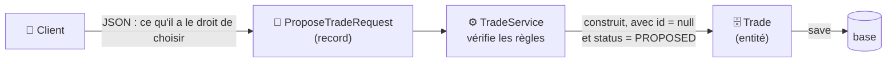
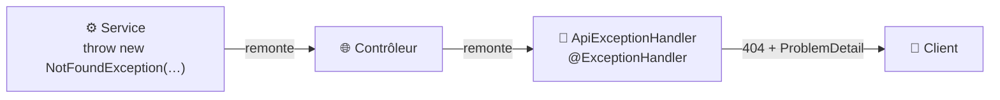

# 📨 Fiche 4 — DTO, validation, erreurs

> `TP N` = notion vue à partir du TP N · ✅ à faire · ❌ à éviter · ⚠️ piège · 💡 astuce

## 🎯 Entité ou objet de requête ? · `TP 4`



| | 📨 Objet de requête (DTO) | 🗄️ Entité |
|---|---|---|
| Contient | ce que le client **peut** choisir | tout ce qui est enregistré |
| Construit par | Jackson, à partir du JSON | le **service**, après ses vérifications |
| Forme | `record` (immuable) | classe avec getters / setters |
| troc-api | `ProposeTradeRequest`, la requête d'inscription (TP 5) | `User`, `Item`, `Trade` |

- ❌ `@RequestBody Trade trade` : le client choisit `id`, `status`… (*mass assignment*)
- ✅ `@RequestBody ProposeTradeRequest request` : une clé JSON inconnue (`"status"`, `"id"`) est **ignorée**
- 💡 le DTO documente le contrat de la route : ses champs sont exactement ce qu'il faut envoyer (visible dans Swagger UI)
- 🔒 `TP 5` : un DTO de **réponse** aussi, pour ne jamais renvoyer `passwordHash` ; ❌ pas de champ `role` dans la requête d'inscription

## 📝 Record · `TP 3`

```java
public record ProposeTradeRequest(Long proposerId, Long offeredItemId, int offeredQuantity,
                                  Long recipientId, Long requestedItemId, int requestedQuantity) {
}
```

| Java génère | Utilisation |
|---|---|
| constructeur avec tous les composants | `new ProposeTradeRequest(1L, 1L, 3, 2L, 2L, 4)` |
| un accesseur par composant (**sans** `get`) | `request.offeredQuantity()` |
| `equals`, `hashCode`, `toString` | `ProposeTradeRequest[offeredItemId=1, …]` dans les logs (TP 8) |

| Composant absent du JSON | Résultat |
|---|---|
| `Long`, `String` | `null` ⚠️ penser au `NullPointerException` |
| `int` | ❌ `400` « Cannot map null into type int » |

## 🔢 Enum · `TP 4`

```java
public enum TradeStatus { PROPOSED, EXECUTED, REJECTED }   // EXECUTED, REJECTED : TP 7
```

- JSON ↔ texte : `"status": "PROPOSED"` · base ↔ `VARCHAR` : `'PROPOSED'` (TP 6)
- valeur inconnue dans le JSON (`"PAYED"`) → `400` au lieu d'être enregistrée
- ✅ comparer avec `==` : `trade.getStatus() != TradeStatus.PROPOSED`
- ⚠️ mais **jamais** deux `Long` avec `==` → `Objects.equals(a, b)`

## 📋 Où vérifier une règle ? · `TP 4`

Ordre de `propose` : **existe** (`404`) → **cohérent en soi** (`400`) → **état des données** (`409`).

| Règle | Où | Code |
|---|---|:-:|
| champ obligatoire, quantité > 0 | 📨 DTO (`@Valid`, bonus) ou service | `400` |
| utilisateur, objet existent | ⚙️ service (`userService.findById` lève le `404`) | `404` |
| pas de troc avec soi-même, objet au bon propriétaire | ⚙️ service | `400` |
| stock suffisant, `max-pending` atteint | ⚙️ service (dépend des données) | `409` |
| seul le destinataire répond | ⚙️ service | `403` (TP 7) |

✅ `TradeService` reçoit `UserService` et `ItemService` (leurs `findById` font déjà le `404`) · ❌ `ItemService` ne reçoit jamais `TradeService` (cycle, fiche 1)

## 🚨 Lever une erreur HTTP · `TP 2`

```java
throw new ResponseStatusException(HttpStatus.CONFLICT, "Stock insuffisant");   // org.springframework.web.server
```

```java
public Trade findById(Long id) {
    return trades.findById(id).orElseThrow(() ->
            new ResponseStatusException(HttpStatus.NOT_FOUND, "Troc " + id + " introuvable"));
}
```

| `Optional` | Rôle | TP |
|---|---|:-:|
| `orElseThrow(() -> …)` | la valeur, ou lever une exception | 2 |
| `isPresent()`, `isEmpty()` | tester | 2 |
| `filter(x -> …)` | garder la valeur si elle respecte la condition | 6 |
| `ifPresent(x -> …)` | agir seulement s'il y a une valeur | 6 |
| `orElseGet(() -> …)` | la valeur, ou en construire une | 7 |

- ⚠️ `IllegalArgumentException`, `NullPointerException` → `500`
- ⚠️ message absent de la réponse → `spring.web.error.include-message=always` (fiche 2)

## ✔️ Valider avec `@Valid` · `TP 2` (bonus)

Dépendance `spring-boot-starter-validation`, puis :

```java
public record ProposeTradeRequest(@NotNull Long proposerId,        // jakarta.validation.constraints
                                  @Positive int offeredQuantity, …) { }
```

```java
public ResponseEntity<Trade> propose(@Valid @RequestBody ProposeTradeRequest request) { … }
```

| Annotation | Refuse |
|---|---|
| `@NotNull` | `null` |
| `@NotBlank` | `null`, `""`, `"   "` |
| `@Positive` / `@PositiveOrZero` | `≤ 0` / `< 0` |
| `@Size(max = 100)` | texte trop long |
| `@Email` | adresse mal formée |

- ✅ dans le DTO : ce qui se vérifie **sans** la base · ❌ « l'objet appartient au proposeur » reste dans le service
- 💡 sur un record `@ConfigurationProperties` : `@Validated` + `@Positive` → l'application **refuse de démarrer** (TP 3, bonus)

## 🧭 Centraliser les erreurs : `@RestControllerAdvice` · `TP 2` (bonus)



```java
@RestControllerAdvice                                     // s'applique à tous les contrôleurs
public class ApiExceptionHandler {

    @ExceptionHandler(NotFoundException.class)
    public ResponseEntity<ProblemDetail> handleNotFound(NotFoundException e) {
        ProblemDetail problem = ProblemDetail.forStatusAndDetail(HttpStatus.NOT_FOUND, e.getMessage());
        return ResponseEntity.status(HttpStatus.NOT_FOUND).body(problem);
    }
}
```

- `NotFoundException extends RuntimeException`, dans `fr.cours.troc.common` : le service ne connaît plus HTTP
- ⚠️ `RuntimeException`, pas `Exception` : sinon `@Transactional` ne fait pas de `ROLLBACK` (fiche 6)
- 💡 `ProblemDetail` : corps d'erreur standard (RFC 9457) → `{"type", "title", "status", "detail", "instance"}`

## ⌨️ IntelliJ · `TP 4`

⭐ = aide Spring, IntelliJ **Ultimate** (licence étudiante gratuite) · raccourcis Windows / Linux ; macOS et liste générale : [fiche 10](10-raccourcis-intellij.md)

| Raccourci | Effet |
|---|---|
| `Alt+Entrée` sur le nom d'une classe | **Convert to record** (classe à champs `final`) |
| `Alt+Entrée` sur `TradeStatus.XXX` inexistant | **Create enum constant** |
| `Alt+Entrée` sur un `switch` sur enum | **Create missing branches** : un `case` par constante |
| `Ctrl+Alt+C` sur un message d'erreur | l'extraire en constante (réutilisé dans le service et le handler) |

## 🚨 Erreurs fréquentes

| Symptôme | 🔎 Cause | TP |
|---|---|:-:|
| `400` « Cannot map null into type int » | quantité absente du JSON, ou clé mal nommée (`"quantity"` au lieu de `"offeredQuantity"`) | 4 |
| `500` sur `POST /trades` | `NullPointerException` (champ `null`) · deux `Long` comparés avec `==` | 4 |
| `"status"` absent du JSON de la réponse | getter manquant dans l'entité | 4 |
| le client a pu choisir `id` ou `status` | le contrôleur reçoit l'entité au lieu du DTO | 4 |
| `@Valid` sans effet | dépendance `spring-boot-starter-validation` absente · `@Valid` oublié devant `@RequestBody` | 2 |
| `… form a cycle` | `ItemService` ↔ `TradeService` (fiche 1) | 4 |

## 🔗 Pour aller plus loin

[dev.java — Records](https://dev.java/learn/records/) · [dev.java — Enums](https://dev.java/learn/classes-objects/enums/) · [OWASP — Mass Assignment](https://cheatsheetseries.owasp.org/cheatsheets/Mass_Assignment_Cheat_Sheet.html) · [Spring — Exceptions](https://docs.spring.io/spring-framework/reference/web/webmvc/mvc-controller/ann-exceptionhandler.html) · [Contraintes de validation](https://jakarta.ee/specifications/bean-validation/3.1/apidocs/jakarta/validation/constraints/package-summary)
