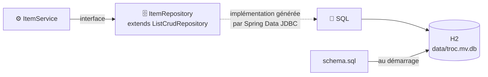

# 🗄️ Fiche 6 — Persistance et transactions

> `TP N` = notion vue à partir du TP N · ✅ à faire · ❌ à éviter · ⚠️ piège · 💡 astuce

## 🧱 Les pièces · `TP 6`



| Fichier | Rôle |
|---|---|
| `pom.xml` | `spring-boot-starter-data-jdbc` · `h2` (`runtime`) · `spring-boot-h2console` |
| `application.properties` | URL de la base, exécution de `schema.sql`, console, traces SQL |
| `src/main/resources/schema.sql` | les tables, écrites à la main |
| entité (`@Table`, `@Id`) | une ligne de la table |
| interface repository | les requêtes, générées par Spring |

## ⚙️ Configuration · `TP 6`

```properties
spring.datasource.url=jdbc:h2:file:./data/troc;CASE_INSENSITIVE_IDENTIFIERS=TRUE
spring.datasource.username=sa
spring.datasource.password=
# schema.sql à chaque démarrage
spring.sql.init.mode=always
# console web sur /h2-console
spring.h2.console.enabled=true
# voir le SQL envoyé
logging.level.org.springframework.jdbc.core.JdbcTemplate=DEBUG
```

| URL | Base | TP |
|---|---|:-:|
| `jdbc:h2:file:./data/troc` | fichier `data/troc.mv.db`, survit à l'arrêt · ✅ `data/` dans `.gitignore` | 6 |
| `jdbc:h2:mem:troc` | en mémoire, vide à chaque lancement | 6 (bonus), 9 |

⚠️ `;CASE_INSENSITIVE_IDENTIFIERS=TRUE` obligatoire : sinon « Table "users" not found ».

## 📜 `schema.sql` · `TP 6`

```sql
CREATE TABLE IF NOT EXISTS items (
    id        BIGINT GENERATED BY DEFAULT AS IDENTITY PRIMARY KEY,
    owner_id  BIGINT NOT NULL REFERENCES users(id),
    name      VARCHAR(100) NOT NULL,
    quantity  INT NOT NULL CHECK (quantity >= 0),
    UNIQUE (owner_id, name)
);
```

| Syntaxe | Garantie |
|---|---|
| 🔑 `… GENERATED BY DEFAULT AS IDENTITY PRIMARY KEY` | id attribué par la base (1, 2, 3…) |
| ❗ `NOT NULL` | colonne obligatoire |
| 🔗 `REFERENCES users(id)` | **clé étrangère** : l'utilisateur doit exister, et ne peut plus être supprimé tant qu'il est référencé |
| ✔️ `CHECK (quantity >= 0)` | toute valeur négative est refusée |
| 1️⃣ `UNIQUE (owner_id, name)` | un seul « tomates » par propriétaire |
| 🔤 `status VARCHAR(20) NOT NULL` | une `enum` Java, en texte |

- ✅ créer une table **après** celles qu'elle référence (`users` → `items` → `trades`)
- ⚠️ `users` et non `user` (mot réservé)
- ⚠️ `IF NOT EXISTS` : modifier un `CREATE TABLE` existant **n'a aucun effet** → arrêter, **supprimer `data/`**, relancer
- 💡 le code **vérifie** (code clair au client), la base **garantit** (même si le code se trompe)

## 🧩 Entité · `TP 6`

```java
@Table("items")                  // org.springframework.data.relational.core.mapping.Table
public class Item {
    @Id                          // ✅ org.springframework.data.annotation.Id · ❌ jakarta.persistence.Id
    private Long id;             // null → INSERT, la base attribue l'id
    private Long ownerId;        // ↔ owner_id (camelCase ↔ snake_case, automatique)
    private String name;
    private int quantity;
    // constructeur sans paramètre, getters, setters
}
```

- ✅ relier par **identifiant** (`Long ownerId`), pas par objet (`User owner`)
- ⚠️ le nom de la colonne **suit** celui du champ

## 📚 Repository · `TP 6`

```java
public interface ItemRepository extends ListCrudRepository<Item, Long> {    // <entité, type de l'id>
    List<Item> findByOwnerId(Long ownerId);
    long countByOwnerId(Long ownerId);
    Optional<Item> findByOwnerIdAndName(Long ownerId, String name);
}
```

| Fourni sans rien écrire | SQL |
|---|---|
| `save(x)` | `INSERT` si `id == null` (id recopié dans l'objet renvoyé), sinon `UPDATE … WHERE id = ?` |
| `findById(id)` → `Optional` | `SELECT … WHERE id = ?` |
| `findAll()` → `List` | `SELECT …` |
| `deleteById(id)`, `count()`, `existsById(id)` | |

**🔤 Méthodes dérivées :** `find` / `count` / `exists` / `delete` + `By` + **champs** de l'entité + `And` / `Or`.

| Méthode | SQL | TP |
|---|---|:-:|
| `findByOwnerId(Long ownerId)` | `WHERE owner_id = ?` | 2 → 6 |
| `findByProposerIdOrRecipientId(Long p, Long r)` | `WHERE proposer_id = ? OR recipient_id = ?` | 4 → 6 |
| `countByProposerIdAndStatus(Long p, TradeStatus s)` | `SELECT COUNT(*) … AND status = ?` | 4 → 6 |
| `findByUsername(String username)` → `Optional<User>` | `WHERE username = ?` | 5 |

⚠️ un champ inconnu (`findByOwner`) → erreur **au démarrage**, qui cite la méthode · ✅ supprimer chaque `InMemory…Repository`

## 🖥️ Console H2 · `TP 6`

<http://localhost:8080/h2-console> · **JDBC URL** = **exactement** `spring.datasource.url` · **User Name** `sa` · mot de passe vide

```sql
SELECT * FROM items ORDER BY owner_id, name;
INSERT INTO items (owner_id, name, quantity) VALUES (99, 'radis', 5);   -- refusé : clé étrangère
```

⚠️ un `DELETE` tapé ici s'applique pour de vrai · ❌ jamais activée en production

## 🔁 Transaction : tout ou rien · `TP 7`

```
Contrôleur ──accept(…)──▶ [ proxy : BEGIN ] ──▶ TradeService.accept(…) : 5 écritures
                          [ proxy : COMMIT si fin normale · ROLLBACK si une RuntimeException sort ]
```

```java
@Transactional                       // ✅ org.springframework.transaction.annotation
public Trade accept(Long tradeId, Long userId) { … }
```

| Où mettre `@Transactional` | |
|---|:-:|
| méthode **publique du service** qui porte l'opération complète (`accept`) | ✅ |
| contrôleur | ❌ trop haut |
| chaque écriture | ❌ inutile, chaque `save()` l'est déjà |
| opération à une seule écriture (`reject`) | ❌ déjà atomique |
| méthode d'un autre service appelée **depuis** `accept` (`itemService.transfer`) | ❌ elle rejoint la transaction ouverte |

**⚠️ Pièges : le proxy n'est pas traversé, ou ne voit pas l'exception**

| Piège | Pourquoi |
|---|---|
| appel interne `this.accept(…)` | ne passe pas par le proxy |
| méthode `private`, classe qui n'est pas un bean | le proxy n'intercepte que les méthodes publiques d'un bean |
| `try { … } catch (…) { }` sans relancer | le proxy ne voit rien → `COMMIT` |
| exception **vérifiée** (pas `RuntimeException`) | pas de `ROLLBACK` par défaut → `rollbackFor = Exception.class` |

- ✅ `ResponseStatusException` et les erreurs SQL sont des `RuntimeException`
- ✅ **revérifier avant d'écrire** (stocks), puis écrire
- 💡 transaction courte : ni e-mail, ni appel externe, ni attente dedans

**🛡️ Trois niveaux de protection**

| Niveau | Rôle | Effet |
|---|---|---|
| ⚙️ le service **vérifie** | répondre clairement, avant d'écrire | `409` au lieu de `500` |
| 🔁 la transaction **protège** | annuler ce qui est déjà écrit | stocks intacts |
| 🧱 les contraintes **garantissent** | refuser l'incohérent, même si le code se trompe | `CHECK` bloque le stock négatif |

## ⌨️ IntelliJ · `TP 6`

⭐ = aide Spring, IntelliJ **Ultimate** (licence étudiante gratuite) · raccourcis Windows / Linux ; macOS et liste générale : [fiche 10](10-raccourcis-intellij.md)

| Raccourci | Effet |
|---|---|
| `Ctrl+F12` deux fois dans votre repository | les méthodes héritées de `ListCrudRepository` (`save`, `findById`, `findAll`…) |
| ⭐ `findBy` + `Ctrl+Espace` dans un repository | les champs de l'entité : méthode dérivée sans faute de frappe |
| ⭐ **View > Tool Windows > Database** | parcourir la base H2 dans l'IDE · ⚠️ base fichier verrouillée tant que l'application tourne |
| ⭐ bandeau en haut de `schema.sql` | choisir le dialecte **H2** : complétion et erreurs SQL |
| `Ctrl+Shift+N` `schema` | ouvrir `schema.sql` sans fouiller l'arborescence |

## 🚨 Erreurs fréquentes

| Symptôme | 🔎 Cause | TP |
|---|---|:-:|
| « Table "users" not found (candidates are: "USERS") » | `CASE_INSENSITIVE_IDENTIFIERS=TRUE` absent de l'URL | 6 |
| `Syntax error … CREATE TABLE IF NOT EXISTS USER` | table nommée `user` | 6 |
| `Table "USERS" already exists` | `IF NOT EXISTS` oublié | 6 |
| colonne ajoutée introuvable | table déjà existante : supprimer `data/` | 6 |
| `Column "OWNERID" not found`, champ toujours `null` | colonne qui ne suit pas le champ (`owner_id`) | 6 |
| `Referential integrity constraint violation` au démarrage | table créée avant celle qu'elle référence | 6 |
| `No property 'owner' found for type 'Item'` | méthode dérivée qui cite un champ inexistant | 6 |
| `required a single bean, but 2 were found` | un `InMemory…Repository` est resté | 6 |
| `Failed to instantiate [fr.cours.troc.item.Item]` | constructeur sans paramètre manquant | 6 |
| `id` toujours `null` | `jakarta.persistence.Id` au lieu de `org.springframework.data.annotation.Id` | 6 |
| « Database may be already in use » | 2 instances ouvrent le même fichier H2 | 6 |
| `500` « Unique index or primary key violation » | doublon : vérifier avant d'écrire (`findByOwnerIdAndName`) → `409` | 6 |
| même résultat avec ou sans `@Transactional` | mauvais import · `private` · appel interne · pas relancé | 7 |
| « Transaction rolled back because it has been marked as rollback-only » | exception levée par un **autre bean** `@Transactional` (ex. `itemService.transfer`), puis attrapée dans `accept` | 7 |

## 🔗 Pour aller plus loin

[Spring Data JDBC](https://docs.spring.io/spring-data/relational/reference/jdbc.html) · [Méthodes de requête](https://docs.spring.io/spring-data/relational/reference/jdbc/query-methods.html) · [Initialiser une base](https://docs.spring.io/spring-boot/how-to/data-initialization.html) · [Spring — Transactions](https://docs.spring.io/spring-framework/reference/data-access/transaction/declarative.html) · [ACID](https://fr.wikipedia.org/wiki/Propri%C3%A9t%C3%A9s_ACID)
