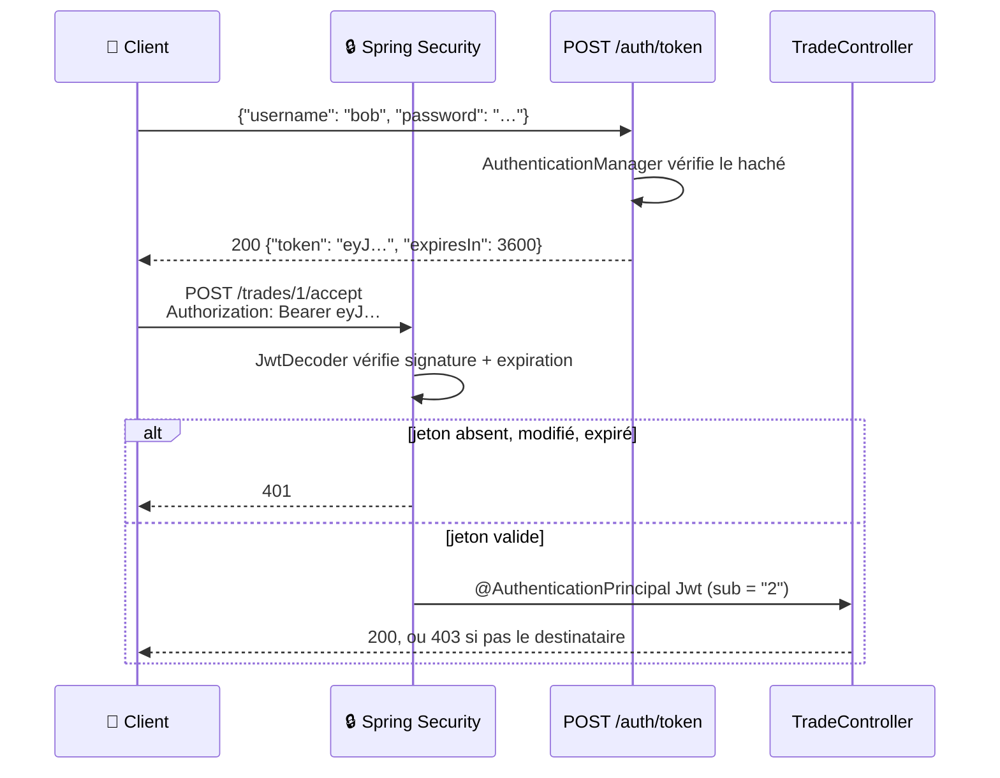

# 🔒 Fiche 8 — Sécurité

> `TP N` = notion vue à partir du TP N · ✅ à faire · ❌ à éviter · ⚠️ piège · 💡 astuce

⚠️ noms de classes tirés du TP 9, *à adapter* à votre projet.

## ❓ Deux questions, dans cet ordre · `TP 9`

| | Question | Si non | Qui répond |
|:-:|---|---|---|
| 1️⃣ | 👤❓ **Authentification** : qui es-tu ? | `401 Unauthorized` (= non authentifié) | Spring Security, **avant** le contrôleur |
| 2️⃣ | ⛔ **Autorisation** : as-tu le droit ? | `403 Forbidden` | Spring Security (rôles) ou **votre service** (destinataire) |

❌ le client ne **déclare** pas son identité (`"userId": 2` dans le corps) · ✅ il la **prouve** (jeton signé)

## 🎟️ Le parcours d'un jeton · `TP 9`



## 📦 Dépendances · `TP 9`

| Starter | Rôle |
|---|---|
| `spring-boot-starter-security` | filtres, hachage, tout est **fermé** par défaut |
| `spring-boot-starter-security-oauth2-resource-server` | lire et vérifier `Authorization: Bearer …` |
| `spring-boot-starter-security-test` (`test`) | `jwt()` dans MockMvc |

❌ `spring-boot-starter-oauth2-resource-server` : nom Boot 3, introuvable en Boot 4

**Sans configuration :** tout en `401` · compte `user` + `Using generated security password: …` · `POST` refusés (CSRF)

## 🔑 Mots de passe · `TP 9`

```java
@Bean
PasswordEncoder passwordEncoder() {
    return PasswordEncoderFactories.createDelegatingPasswordEncoder();   // BCrypt, préfixe {bcrypt}
}
```

| Appel | Rôle |
|---|---|
| `encoder.encode("tomate42")` | haché à enregistrer : `{bcrypt}$2a$10$…` (différent à chaque fois : **sel**) |
| `encoder.matches("tomate42", hache)` | vérifier (fait par l'`AuthenticationManager`) |

- ❌ jamais le mot de passe en base, même chiffré · ✅ son **haché**, lent exprès
- ❌ jamais le haché dans une réponse JSON → **DTO de réponse** (fiche 4)
- ⚠️ `PUT /users/{id}` qui enregistre l'entité reçue → le haché est **effacé**

| Colonne `users` | Contrainte |
|---|---|
| `username` | `VARCHAR(50) NOT NULL UNIQUE` |
| `password_hash` | `VARCHAR(100) NOT NULL` |
| `role` | `VARCHAR(20) NOT NULL DEFAULT 'USER'` · ❌ jamais choisi par le client |

## 🧱 Les beans à fournir · `TP 9`

| Bean | Rôle | Appelé |
|---|---|---|
| `UserDetailsService` | trouver un compte par `username` (`UsernameNotFoundException` sinon) | à la **connexion** seulement |
| `PasswordEncoder` | hacher, vérifier | inscription, connexion |
| `AuthenticationManager` | `UserDetailsService` + `PasswordEncoder` | `POST /auth/token` |
| `SecretKey` | clé HMAC lue dans `TROC_JWT_SECRET` (≥ 32 caractères) | |
| `JwtEncoder` | **signer** un jeton | `POST /auth/token` |
| `JwtDecoder` | **vérifier** un jeton | chaque requête |
| `SecurityFilterChain` | les règles d'accès | chaque requête |

```java
// UserDetails : le User de Spring Security, à ne pas confondre avec votre entité
org.springframework.security.core.userdetails.User
        .withUsername(user.getUsername()).password(user.getPasswordHash()).roles(user.getRole()).build();
```

```java
var provider = new DaoAuthenticationProvider(userDetailsService);
provider.setPasswordEncoder(encoder);
return new ProviderManager(provider);                                      // l'AuthenticationManager
```

```java
new SecretKeySpec(secret.getBytes(StandardCharsets.UTF_8), "HmacSHA256");  // javax.crypto.spec
NimbusJwtEncoder.withSecretKey(key).build();
NimbusJwtDecoder.withSecretKey(key).macAlgorithm(MacAlgorithm.HS256).build();
```

## 🎫 Le JWT · `TP 9`

```
eyJhbGciOiJIUzI1NiJ9 . eyJzdWIiOiIxIiwiZXhwIjoxNzkyNjY2ODAwfQ . DBlqUDT6esOk…
──────────────────     ──────────────────────────────────────     ────────────
 en-tête : HS256        contenu (claims) : sub, exp, roles…        signature
```

| Claim | Sens | Méthode du builder |
|---|---|---|
| `iss` | émetteur (`troc-api`) | `.issuer(…)` |
| `sub` | **qui** : id de l'utilisateur, en `String` | `.subject(…)` |
| `iat` · `exp` | émis à · expire à (secondes depuis 1970) | `.issuedAt(…)` · `.expiresAt(…)` |
| libres | `username`, `roles` | `.claim("roles", List.of(…))` |

- 🔓 **encodé, pas chiffré** : lisible par tous (jwt.io) → ❌ jamais de secret dedans
- 🔏 **signé** : modifié sans la clé → signature fausse → `401`
- ⚠️ `JwsHeader.with(MacAlgorithm.HS256)` obligatoire, sinon l'encodeur attend une clé RSA

```java
authenticationManager.authenticate(UsernamePasswordAuthenticationToken.unauthenticated(username, password));
// AuthenticationException → 401, même message que le compte existe ou non
```

## 🚧 Les règles d'accès · `TP 9`

```java
@Bean
SecurityFilterChain securityFilterChain(HttpSecurity http) throws Exception {
    http
        .authorizeHttpRequests(auth -> auth
            .requestMatchers(HttpMethod.POST, "/chemin", "/autre").permitAll()
            .requestMatchers("/un-dossier/**").permitAll()
            .anyRequest().authenticated())                               // ✅ toujours en dernier
        .oauth2ResourceServer(rs -> rs.jwt(Customizer.withDefaults()))  // Bearer exigé
        .csrf(csrf -> csrf.disable())                                    // pas de cookie → pas de CSRF
        .sessionManagement(s -> s.sessionCreationPolicy(SessionCreationPolicy.STATELESS))
        .headers(h -> h.frameOptions(f -> f.sameOrigin()));              // console H2
    return http.build();
}
```

- les règles se lisent de haut en bas : la **première** qui correspond gagne
- 🔍 à ouvrir aussi : `/h2-console/**` · `/error` · Swagger UI (`/swagger-ui.html`, `/swagger-ui/**`, `/v3/api-docs/**`)
- 👑 bonus : `.requestMatchers(HttpMethod.DELETE, "/users/**").hasRole("ADMIN")`, ou `@EnableMethodSecurity` + `@PreAuthorize("hasRole('ADMIN')")` (un proxy, comme `@Transactional`)

## 🪪 Lire l'identité · `TP 9`

```java
@PostMapping("/{id}/accept")
public Trade accept(@PathVariable Long id, @AuthenticationPrincipal Jwt jwt) {   // oauth2.jwt.Jwt
    Long userId = Long.valueOf(jwt.getSubject());                                  // déjà vérifié
    …
}
```

✅ le service ne change presque pas : seule la **provenance** de l'id change · `proposerId` et `userId` disparaissent des corps

## 🐶 Bruno · `TP 9`

1. Requête `POST {{baseUrl}}/auth/token` dans un dossier **Authentification**, onglet **Script > Post Response** : `bru.setVar("token", res.body.token);`
2. Collection > **Settings > Auth** : **Bearer Token** `{{token}}`
3. Chaque requête, onglet **Auth** : **Inherit**

## ⌨️ IntelliJ · `TP 9`

⭐ = aide Spring, IntelliJ **Ultimate** (licence étudiante gratuite) · raccourcis Windows / Linux ; macOS et liste générale : [fiche 10](10-raccourcis-intellij.md)

| Raccourci | Effet |
|---|---|
| `Ctrl+N` **deux fois** + `BearerTokenAuthenticationFilter` | ouvrir une classe de Spring Security (hors projet) · **Download Sources** si proposé |
| point d'arrêt dans ce filtre + **Debug** | voir pourquoi un jeton est refusé (`401`) |
| `Ctrl+Q` sur `requestMatchers` / `permitAll` | la documentation de la règle |
| `Ctrl+Alt+V` sur `jwt.getClaim("…")` | nommer la valeur lue dans le jeton avant de l'utiliser |

## 🚨 Erreurs fréquentes

| Symptôme | 🔎 Cause | TP |
|---|---|:-:|
| `401` partout | pas encore de `SecurityFilterChain` · route non ouverte | 9 |
| `409` attendu, `401` reçu avec un corps vide | `/error` est protégé : l'ouvrir | 9 |
| `401` avec un jeton | expiré, mal copié, `Bearer ` oublié → lire l'en-tête `WWW-Authenticate` | 9 |
| `403` sur chaque `POST`, `PUT`, `DELETE` | CSRF encore actif | 9 |
| `The secret length must be at least 256 bits` | clé < 32 caractères · `TROC_JWT_SECRET` absente | 9 |
| `There is no PasswordEncoder mapped for the id "null"` | mot de passe inséré à la main, sans `{bcrypt}` | 9 |
| `jwt == null` dans un test | `@WithMockUser` au lieu de `.with(jwt())` | 9 |
| console H2 blanche | `frameOptions(… sameOrigin())` oublié | 9 |
| `passwordHash` dans un JSON | l'entité est renvoyée au lieu d'un DTO de réponse | 9 |
| tutoriel avec `WebSecurityConfigurerAdapter`, `antMatchers`, `.and()`, `jjwt` | Spring Security 5 : en version 7, bean `SecurityFilterChain`, `requestMatchers`, lambdas, `oauth2ResourceServer` | 9 |

💡 `logging.level.org.springframework.security=DEBUG` : chaque filtre traversé et la raison du refus.

## 🔗 Pour aller plus loin

[Spring Security — Architecture](https://docs.spring.io/spring-security/reference/servlet/architecture.html) · [Resource Server JWT](https://docs.spring.io/spring-security/reference/servlet/oauth2/resource-server/jwt.html) · [Password Storage](https://docs.spring.io/spring-security/reference/features/authentication/password-storage.html) · [OWASP — Passwords](https://cheatsheetseries.owasp.org/cheatsheets/Password_Storage_Cheat_Sheet.html) · [jwt.io](https://jwt.io/introduction) · `doc/cours/05-annexe-spring-security.html`
